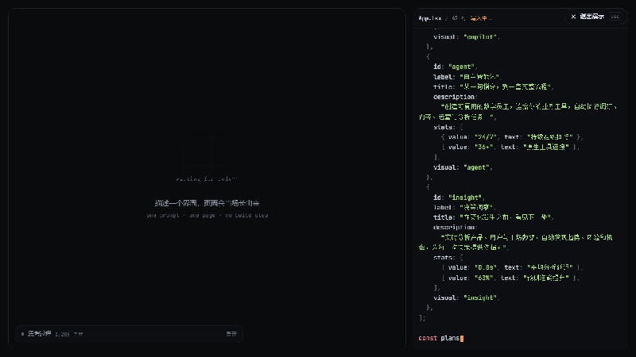
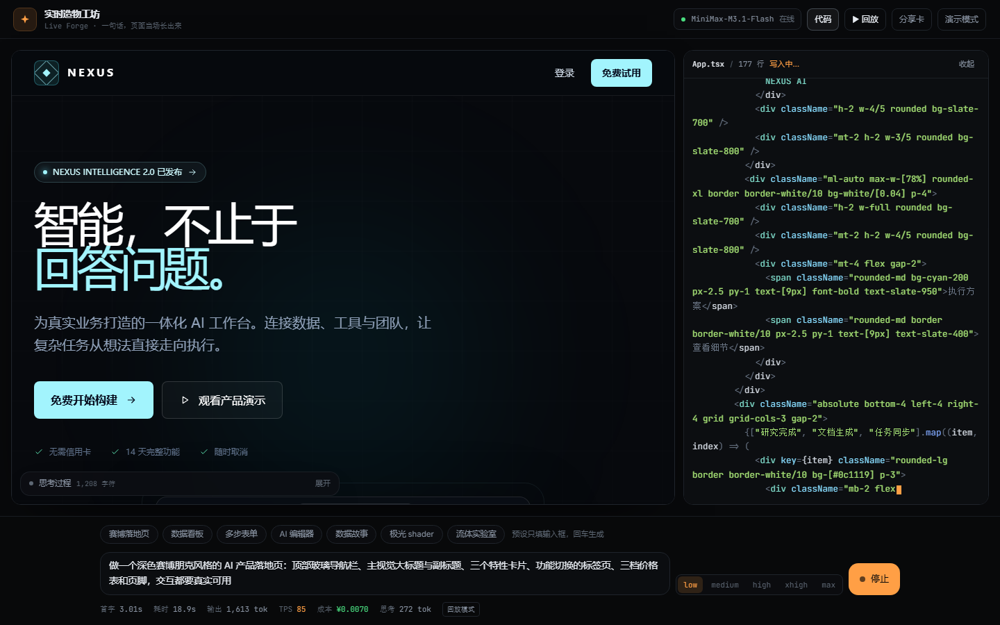

# prompt-to-page · 实时造物工坊

> 一句话，页面当场长出来。
> MiniMax M3.1 Flash 前端能力的现场演示 —— 200+ TPS 的流式代码，在浏览器里实时编译成能点的页面。



> 上图是「回放」模式：录制自一次真实调用（2228 个增量事件，82.3s），回放时把时间轴重排到 32.6 秒 —— 慢到眼睛能跟住流出的代码。



| | |
|---|---|
| 在线体验 | `npm run dev` → http://localhost:5173 |
| 模型 | MiniMax-M3.1-Flash（1M 上下文 / 200+ TPS） |
| 成本 | 一次完整页面生成约 **¥0.008 ~ ¥0.02** |
| 技术栈 | React 19 · Tailwind v4 · Vite 8 · Hono(SSE) · sucrase |

---

## 这是什么

一个「观众自己打一句话，页面当场长出来」的网页：

1. 输入框里敲一句中文需求 → 回车；
2. 右侧代码流以 200+ TPS 的速度实时写出 React + Tailwind 代码；
3. 左侧预览区在几秒内渲染出**可交互**的成品页面（按钮能点、标签页能切）；
4. 底部 HUD 实时显示首字延迟、输出 token、TPS 和**这次生成花了多少钱**。

整个过程没有构建步骤：TSX 在浏览器里编译，React 运行时和 Tailwind v4 全部自托管，断网也能跑。

实测（`effort=low`）：

| 需求 | 首字 | 首码 | 成品 | 输出 | TPS | 成本 |
|---|---|---|---|---|---|---|
| 极简番茄钟 | 5.4s | 6.6s | **17.7s** | 1,832 tok | 222（峰值） | ¥0.0078 |
| 深色播客订阅页 | 1.1s | 1.8s | **39.6s** | 4,992 tok | 126 | ¥0.0195 |

成品是可交互的：按钮能点、标签页能切、折叠能展开。

## 快速开始

```bash
npm install
cp .env.example .env   # 填入 MINIMAX_API_KEY
npm run dev            # http://localhost:5173（vendor 会自动生成）
```

没有 key 也能玩：首屏直接渲染录制好的成品，点顶栏「▶ 回放」按重排后的时间轴回放一次真实生成。

生产部署：

```bash
npm run build && npm start   # 单进程同时提供 API 与静态资源，默认 8787
```

## 运行时数据流

```
用户输入 ──▶ /api/stream ──▶ MiniMax-M3.1-Flash ──▶ 流解析器 ──▶ 编译 ──▶ 全屏预览
  (SSE 代理)   (Hono)          thinking + text 双流    抽 ```tsx   (sucrase)   (iframe 沙箱)
                     ▲                                          节流 60ms
                     └──── 报错回喂：Agent 自己改代码 ────────────┘
```

- **SSE 代理**：密钥只留在服务端；把 Anthropic 兼容事件翻译成前端协议。
- **流解析器**：边收边从 ```` ```tsx ```` 围栏里抽代码，60ms 节流一次 state 更新。
- **编译器**：`sucrase` 在主线程把 TSX 转成 JS（改成绝对 URL 指向自托管的 React）。
- **沙箱**：`<iframe srcdoc>` + Tailwind v4 浏览器版，免构建出样式；运行时报错通过 `postMessage` 回传。

## 两处让它「像回事」的设计

### 报错要闭环

沙箱里运行时抛错 → 错误堆栈回喂模型 → 模型改代码 → 重编译。最多自动修一次，仍失败则展示错误并允许手动「再修一次」。

**GLSL 编译失败也算错误。** 模型写 shader 时漏掉一个 `uniform vec2 u_resolution;`，片段着色器就编译不过 —— 而组件里普遍写成「编译不过就 return」，错误被静默吞掉，预览只剩一张静止黑图。这种错误 JS 侧抓不到，所以在编译阶段做了一次 GLSL 静态检查（`src/lib/compile.ts`），把它变成普通错误接回上面这条回路。

实测：注入一个真实坏样本 → 0.1s 内报出「未声明的 u_resolution」→ 修复回路自动启动 → 20s 后模型自己补上声明 → 画面动起来。

### HUD 上的数字是真的

回放模式尤其容易骗人：时间轴被压缩过，如果拿回放墙钟算 TPS，会得到 615 —— 而那次录制**真实**只有 131。

所以回放时 HUD 全部映射回录制时的真实时间轴：耗时、token、TPS、成本终态与首屏 `loadDemo` 展示的数值逐项一致（`npm run ui-check` 会拿录制件原始数据比对，差 5% 以上就失败）。

## Shader 实验室

除了页面，也能让模型写**原生 WebGL shader** —— 浏览器 `<canvas>` + `getContext('webgl')`，不引入任何第三方包。

底部预设里多了「极光 shader」「流体实验室」两个入口。产出的是全屏动态画面，带真实可调参数（速度 / 色相 / 强度滑块，几种形态之间切换），滑块直接接进 uniform。

GLSL 源码必须写成 JS 字符串常量（写在 ```` ```tsx ```` 块内的模板字符串里），这一点写进了输出契约：只有 tsx 块的内容会被取用，块外的 ```glsl 块会被丢掉。

## 目录

```
live-forge/
├─ src/
│  ├─ components/     Preview 沙箱 / CodePanel 代码流 / Stage / Composer / Hud / ShareSheet
│  │                  / ThinkingPanel / TopBar / CinemaExit
│  ├─ lib/
│  │  ├─ tokenize.ts  自研 JSX 感知词法分析（代码流上色 + canvas 画分享卡共用）
│  │  ├─ compile.ts   TSX → JS，改写裸模块说明符为自托管绝对地址；含 GLSL uniform 静态检查
│  │  ├─ previewShell.ts  注入沙箱的 HTML
│  │  ├─ presets.ts   输入框预设（页面 + shader）
│  │  └─ shareCard.ts 1200×630 分享卡（纯 canvas，零依赖）
│  ├─ store.ts        zustand：流式状态机 + 指标 + 修复回路
├─ server/
│  ├─ index.ts        Hono：/api/stream (SSE) /api/repair /api/health /api/demos
│  └─ prompt.ts       输出契约（system prompt）
├─ shared/extract.ts  流式代码抽取（前后端共用）
├─ scripts/
│  ├─ dev.mjs         自写 dev runner（见下方备注）
│  ├─ record.ts       录制一次真实生成 → public/demos/*.json
│  ├─ capture.mjs     录屏转 GIF（README 用）
│  ├─ e2e.mjs / shot.mjs / ui-check.mjs   自动化验证
│  ├─ shader-lint.ts  GLSL 静态检查的回归测试（不烧 API）
│  ├─ shader-check.mjs  坏 shader → 自动修复 → 画面动起来（整条闭环）
│  └─ fixtures/       真实产出的坏样本，供上面两个脚本用
├─ public/demos/      录制好的回放件
└─ public/vendor/     构建产物（React 运行时 + Tailwind 浏览器版）
```

## 几个刻意的设计决定

**为什么不用 Sandpack。** 它的打包在远程 codesandbox.io 完成，国内首包常 3–8s 且会挂，而这个 demo 的核心就是「当场长出来」。改成自建沙箱后编译在本地、<50ms，且 React 运行时自托管成单个 bundle（保证只有一个 React 实例，否则 hooks 会炸），完全离线可用。

**输出契约要硬。** `server/prompt.ts` 里约束了：单个文件、`export default function App()`、禁止 import 第三方包、图标必须内联 SVG、只用 Tailwind 内置类、交互必须真实。契约越硬，产出越能直接跑。

**默认思考档是 `low`。** 实测 `max` 档会先思考 91 秒（19k 字符）才开始吐代码，演示节奏会垮；`low` 档首字 1.2s。档位在输入框右侧可实时切换。

**错误要闭环。** 见上文「报错要闭环」。

**自己写 dev runner。** 这台 Windows 机器上 `concurrently` 拉起的 `tsx watch` 会秒退并吞掉输出（vite 随之被一起杀掉），所以 `scripts/dev.mjs` 用 `child_process` 自己 spawn 两个进程。

## 脚本

| 命令 | 作用 |
|---|---|
| `npm run dev` | 同时起 vite(5173) 与 API(8787)（自动先跑 vendor） |
| `npm run record -- "<prompt>" <id> [title]` | 录制一次真实生成，存成回放件 |
| `npm run capture` | 录屏转 GIF（README 用） |
| `npm run e2e -- "<prompt>"` | 端到端验证：流式 → 编译 → 预览出图 |
| `npm run ui-check` | 分享卡 / 回放 / 演示模式 / 移动端 界面检查 |
| `npm run shader-lint` | GLSL 静态检查回归（纯静态，不烧 API） |
| `npm run shader-check` | 坏 shader → 自动修复 → 画面动起来（需 dev server，会烧 API） |
| `npm run shot` | 截图 + 抓控制台错误 |
| `node scripts/repair-check.mjs` | 验证「报错 → 模型自己改」回路 |

## 已知边界

- 生成物限定为**单个 React 组件文件**。多文件工程要靠 1M 上下文另做一套装配，不在当前范围内。
- GLSL 静态检查只覆盖「uniform 用了但没声明」这一类。GLSL 还有别的错法（类型不匹配、函数未定义等）仍会被组件吞掉，表现为黑屏 —— 遇到黑屏是这个洞，不是回放问题。
- 预览沙箱是 `allow-scripts + allow-same-origin`，同源内容理论上可逃离沙箱；模型产出的代码可信，且本项目不落地敏感数据到前端。
- 沙箱内的 Tailwind 走浏览器版，产物页面若用到 Tailwind 之外的高级特性（插件、自定义主题）不会生效。
- 分享卡目前不含成品截图（canvas 抓不到跨文档的 iframe），只有 prompt + 代码片段 + 指标。
- 窄屏（<768px）默认收起代码面板（它会盖住预览），回放时看不到代码流，点顶栏「代码」可展开。
- 没有图片输入。模型本身支持原生多模态，这个 demo 只做了文本 → 代码这一路。
